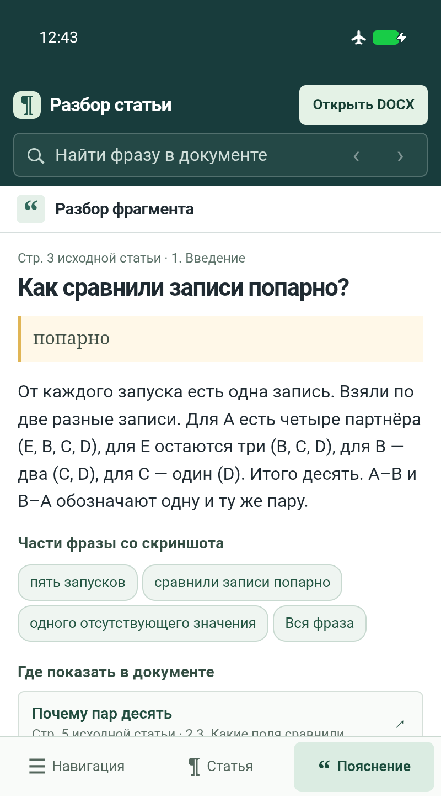
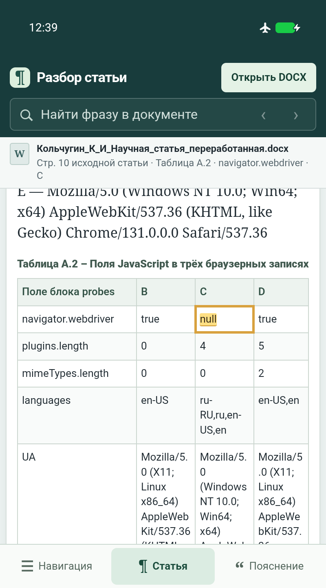

# Разбор статьи

Приложение для защиты исследовательской работы К. И. Кольчугина о признаках бот-трафика. Откройте вопрос преподавателя или удерживайте палец на слове. Приложение покажет пояснение и выделит в статье предложение, формулу или ячейку таблицы, на которую опирается ответ.

## Пример со страницы 3

Во введении сказано, что записи пяти запусков сравнили попарно. В разделе 2.3 на странице 5 показана формула 4 + 3 + 2 + 1 = 10. Второй вопрос касается пропущенного значения. В таблице А.2 на странице 10 приложение выделяет строку `navigator.webdriver`, столбец C и значение `null`.

  
  

## Скачать на Android

Версия 1.0. Статья встроена в APK. Приложение работает без интернета и открывает другие DOCX через системное окно выбора файлов. Запуск, поиск, пояснения и переход к выделенной ячейке проверены на эмуляторе Android 17 в авиарежиме.

[Скачать подписанный APK, 153 КиБ](https://raw.githubusercontent.com/marakirewa-dot/razbor-stati/main/RazborStati-1.0.apk)

**SHA-256 файла** `d0067bb73a602af66a9af7a20c8f88afa6fd07ccd602ebcc5e985c45548ff4e3`
